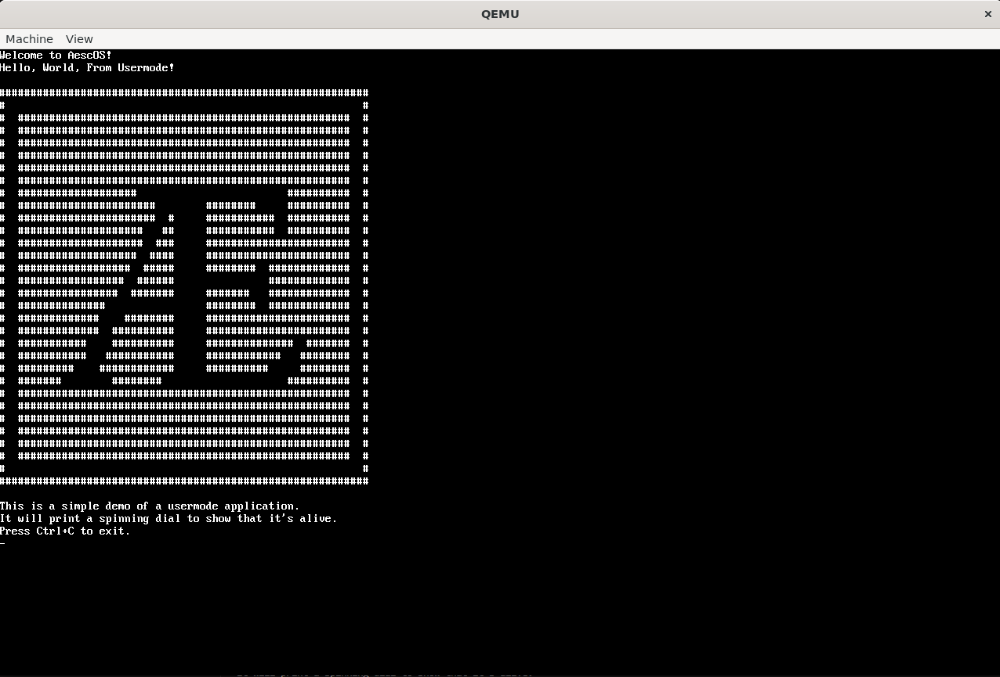

# Clearfall

[](LICENSE)

Clearfall is a hobby operating system written in C and assembly for x86. The project explores low-level system development, including kernel initialization, interrupt handling, memory management, device drivers, scheduling, system calls, and filesystem abstractions.

Clearfall is currently in an **early development stage**. Several kernel components and interfaces are implemented, but the system is not yet fully functional. In particular, keyboard input, terminal line handling, and parts of the scheduler are still being debugged.

**A working interactive shell is not currently available.** The shell depends on reliable input from the device drivers and correct coordination with the scheduler. Because those components are still faulty, shell input and execution cannot yet be relied upon.



## Current Development Status

| Component | Status |
|---|---|
| Kernel initialization | Implemented; ongoing development |
| Interrupt handling | Basic infrastructure implemented |
| PS/2 keyboard input | Implemented; needs debugging |
| Terminal output | Basic implementation available |
| System call interface | Implemented; some calls incomplete or unreliable |
| Virtual filesystem | Basic infrastructure implemented |
| Scheduler | Partially implemented; issues remain |
| Interactive shell | Not currently functional |

## Features and Components

### Kernel Core

- Custom x86 kernel.
- Global Descriptor Table (GDT) initialization.
- Interrupt Descriptor Table (IDT) setup.
- Programmable Interval Timer (PIT) initialization.
- Basic thread and scheduling infrastructure.
- Kernel memory management components.

### Input and Device Drivers

- PS/2 keyboard driver with scancode-to-ASCII translation.
- Keyboard event handling.
- Terminal input buffering.
- Serial port initialization and support.

**Current limitation:** The input path is not fully reliable. Keyboard events, line completion, and waking a thread blocked on input need further debugging.

### Terminal and Output

- Text terminal abstraction (TTY).
- Framebuffer-backed terminal output.
- Kernel output and diagnostic facilities.
- User-facing output through system calls.

### Virtual Filesystem

Clearfall includes a basic Virtual Filesystem (VFS) abstraction intended to provide a common interface for filesystems and user programs.

Available or partially implemented operations include:

- `open`
- `close`
- `read`
- `write`
- `readdir`

RAMFS, FAT, and EXT2 filesystem components are present in the kernel. Their integration and functionality may vary while development continues.

### System Calls

The kernel provides a system call interface using `int 0x80`.

#### Process Management

- `SYS_exit` — terminate a process.
- `SYS_getpid` — retrieve a process identifier.
- `SYS_execve` — basic executable-loading infrastructure; functionality is incomplete.
- `SYS_fork` — not implemented.
- `SYS_waitpid` — not implemented.

#### File Operations

- `SYS_open`
- `SYS_close`
- `SYS_read`
- `SYS_write`
- `SYS_readdir`

The completeness and reliability of individual calls depend on their underlying kernel subsystems.

#### Terminal Operations

- `SYS_print` — terminal output.
- `SYS_scan` — line-based keyboard input; currently unreliable.

## Userland API

A minimal libc layer provides wrappers for kernel services, including:

```c
print(const char *s);
scan(char *buf, int max);

read(fd, buf, count);
write(fd, buf, count);

open(path, flags);
close(fd);

execve(path, argv);
readdir(fd, index, out);

exit(status);
```

These declarations describe the intended userland interface. Some operations remain incomplete or may not work reliably until their kernel implementations are fixed.

## Known Issues and Limitations

### Shell

A functional shell is **not currently available**.

The shell's input loop depends on working keyboard and terminal-input drivers, while its ability to resume after input depends on correct scheduler behavior. Faults in these components prevent reliable interactive input and command processing.

Shell development is therefore on hold until the underlying input and scheduling paths are stable. This is a kernel infrastructure issue rather than simply a missing set of shell commands.

### Device Drivers and Input

- Keyboard input and line completion are not fully reliable.
- Blocking reads and input wake-ups need debugging.
- Backspace and other line-editing behavior require further work.
- Arrow keys and command history are not implemented.
- Serial input support may need additional integration.

### Scheduler

- Thread switching and cooperative scheduling infrastructure are present but still under development.
- Yielding and waking threads may not behave correctly in every situation.
- Scheduling and blocking system calls need further testing.
- Preemptive scheduling is not yet a completed feature.

### Processes and Memory

- Full process isolation is not implemented.
- Independent per-process address spaces are incomplete.
- `fork()` and `waitpid()` are not implemented.
- Executable loading and process lifecycle handling need further development.

### Filesystem

- The VFS is basic and partially incomplete.
- Filesystem mounting and integration need further testing.
- Persistent storage and filesystem operations may not be fully functional.

## Architecture Notes

- **Target architecture:** x86 (32-bit).
- **Implementation languages:** C and assembly.
- **System call mechanism:** `int 0x80`.
- **System call arguments:** passed through registers.

| Register | Purpose |
|---|---|
| `EAX` | System call number |
| `EBX` | Argument 1 |
| `ECX` | Argument 2 |
| `EDX` | Argument 3 |

File descriptors and process-related structures are still under development, and some tables may use static storage rather than fully isolated per-process resources.

## Roadmap

Development is focused on getting the foundational kernel subsystems working reliably before adding higher-level features.

1. **Fix keyboard and TTY input.** Ensure key events are handled correctly, lines are completed reliably, and input buffers remain consistent.
2. **Fix scheduler coordination.** Resolve thread wake-up, yielding, and blocking-read issues.
3. **Restore a functional shell.** Get the prompt and interactive input working before introducing commands.
4. **Stabilize system calls.** Test terminal and filesystem operations from user space.
5. **Improve process management.** Continue work on executable loading, process isolation, and process lifecycle operations.
6. **Improve filesystem support.** Test mounting, file operations, and storage integration.
7. **Expand userland.** Add shell commands and basic user programs after the underlying kernel interfaces are stable.

## Contributing

Contributions, bug reports, testing, and documentation improvements are welcome.
See [CONTRIBUTING.md](CONTRIBUTING.md) for contribution guidelines and information about the project's current development status.

## License

Clearfall is distributed under the MIT License.
See [LICENSE](LICENSE.md) for the full license text.

