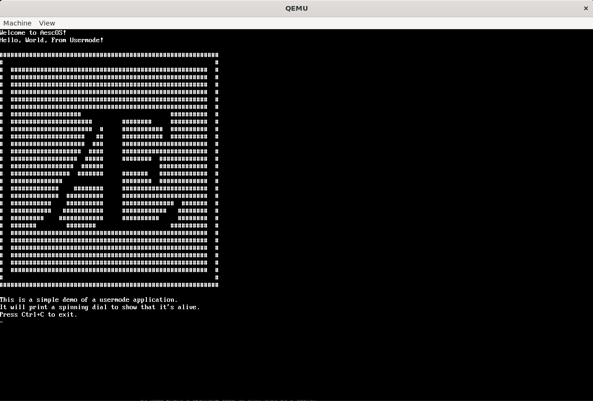

# Clearfall

[](LICENSE)

Clearfall is a hobby operating system written in C and assembly for x86. The project explores low-level system development, including kernel initialization, interrupt handling, memory management, device drivers, scheduling, system calls, and filesystem abstractions.

Clearfall is an experimental system under active development. Kernel subsystems and userland are evolving, and hardware and filesystem support still require broader testing.



<small>old screenshot ik </small>

## Current Development Status

| Component | Status |
|---|---|
| Kernel initialization | Implemented; ongoing development |
| Interrupt handling | Basic infrastructure implemented |
| PS/2 and serial input | Implemented; needs broader testing |
| Terminal output | VGA text mode and optional framebuffer |
| System call interface | Implemented; some calls incomplete or unreliable |
| Virtual filesystem | Basic infrastructure implemented |
| Scheduler | Partially implemented; issues remain |
| Interactive shell | Basic cooked-input shell and external commands |

## Features and Components

### Kernel Core

- Custom x86 kernel.
- Global Descriptor Table (GDT) initialization.
- Interrupt Descriptor Table (IDT) setup.
- Programmable Interval Timer (PIT) initialization.
- Basic thread and scheduling infrastructure.
- Kernel memory management components.

### Input and Device Drivers

- PS/2 Set-1 keyboard input with shift, caps-lock, and punctuation mapping
- COM1 serial input with interrupt and polling fallback
- Echoed, cooked line input shared by the shell and `scan()`

**Current limitation:** Input behavior and blocking reads still need broader hardware testing.

### Terminal and Output
- Single-cursor TTY with a VGA text-mode fallback
- Validated boot-provided VBE framebuffer output when available
- `print()` syscall for user output
- Serial mirroring for debugging output

- Text terminal abstraction (TTY).
- Framebuffer-backed terminal output.
- Kernel output and diagnostic facilities.
- User-facing output through system calls.

### Virtual Filesystem
- Virtual File System abstraction layer
- Basic vnode + file structure
- File descriptor table per process
- `open`, `close`, `read`, `write`, `readdir`
- RAMFS path lookup, directories, file I/O, truncation, and unlink

Clearfall includes a basic Virtual Filesystem (VFS) abstraction intended to provide a common interface for filesystems and user programs.

Available or partially implemented operations include:

- `open`
- `close`
- `read`
- `write`
- `readdir`

RAMFS, FAT, and EXT2 filesystem components are present in the kernel. Their integration and functionality may vary while development continues.

### System Calls

The kernel provides a system call interface using `int 0x80`.

#### Process Management

- `SYS_exit` — terminate a process.
- `SYS_getpid` — retrieve a process identifier.
- `SYS_execve` — basic executable-loading infrastructure; functionality is incomplete.
- `SYS_fork` — not implemented.
- `SYS_waitpid` — not implemented.

#### File Operations

- `SYS_open`
- `SYS_close`
- `SYS_read`
- `SYS_write`
- `SYS_readdir`
- `SYS_print`
- `SYS_scan` (cooked line input)

The completeness and reliability of individual calls depend on their underlying kernel subsystems.

#### Terminal Operations

- `SYS_print` — terminal output.
- `SYS_scan` — line-based keyboard input; currently unreliable.

## Userland API

A minimal libc layer provides wrappers for kernel services, including:

```c
print(const char *s);
scan(char *buf, int max);

read(fd, buf, count);
write(fd, buf, count);

open(path, flags);
close(fd);

execve(path, argv);
readdir(fd, index, out);

exit(status);
```

RAMFS is in-memory and does not persist across boots. FAT and EXT2 support are still under development.

These declarations describe the intended userland interface. Some operations remain incomplete or may not work reliably until their kernel implementations are fixed.

## Known Issues and Limitations
- No command history or cursor movement while editing a line

### Codebase and Technical Debt

Much of the Clearfall codebase consists of older implementations that no longer fully align with the project's intended architecture. Significant portions require rewriting, refactoring, and reformatting to improve consistency, maintainability, and reliability. Some components may contain temporary solutions, incomplete functionality, or outdated design decisions. As development continues, existing code and interfaces may change substantially as the project moves toward a more consistent and stable architecture.

### Shell

The shell supports cooked line input and launching standalone commands from `/bin`. Input handling, process lifecycle behavior, and command coverage remain limited and need additional testing.

### Device Drivers and Input

- Keyboard input and line completion are not fully reliable.
- Blocking reads and input wake-ups need debugging.
- Backspace and other line-editing behavior require further work.
- Arrow keys and command history are not implemented.
- Serial input support may need additional integration.

### Scheduler

- Thread switching and cooperative scheduling infrastructure are present but still under development.
- Yielding and waking threads may not behave correctly in every situation.
- Scheduling and blocking system calls need further testing.
- Preemptive scheduling is not yet a completed feature.

### Processes and Memory

- Full process isolation is not implemented.
- Independent per-process address spaces are incomplete.
- `fork()` and `waitpid()` are not implemented.
- Executable loading and process lifecycle handling need further development.

### Filesystem

- The VFS is basic and partially incomplete.
- Filesystem mounting and integration need further testing.
- Persistent storage and filesystem operations may not be fully functional.

## Architecture Notes

- **Target architecture:** x86 (32-bit).
- **Implementation languages:** C and assembly.
- **System call mechanism:** `int 0x80`.
- **System call arguments:** passed through registers.

| Register | Purpose |
|---|---|
| `EAX` | System call number |
| `EBX` | Argument 1 |
| `ECX` | Argument 2 |
| `EDX` | Argument 3 |

File descriptors and process-related structures are still under development, and some tables may use static storage rather than fully isolated per-process resources.

## Roadmap

Development is focused on getting the foundational kernel subsystems working reliably before adding higher-level features.

1. **Fix keyboard and TTY input.** Ensure key events are handled correctly, lines are completed reliably, and input buffers remain consistent.
2. **Fix scheduler coordination.** Resolve thread wake-up, yielding, and blocking-read issues.
3. **Restore a functional shell.** Get the prompt and interactive input working before introducing commands.
4. **Stabilize system calls.** Test terminal and filesystem operations from user space.
5. **Improve process management.** Continue work on executable loading, process isolation, and process lifecycle operations.
6. **Improve filesystem support.** Test mounting, file operations, and storage integration.
7. **Expand userland.** Add shell commands and basic user programs after the underlying kernel interfaces are stable.

## Contributing

Contributions, bug reports, testing, and documentation improvements are welcome.
See [CONTRIBUTING.md](CONTRIBUTING.md) for contribution guidelines and information about the project's current development status.

## License

Clearfall is distributed under the MIT License.
See [LICENSE](LICENSE.md) for the full license text.

## Repository Layout

- `src/kernel/` contains kernel code grouped by subsystem.
- `src/shared/` contains shared freestanding library and syscall code.
- `src/user/` contains user programs and startup code.
- `include/kernel/` and `include/libc/` contain public headers.
- `archive/legacy/` retains unbuilt implementations.
